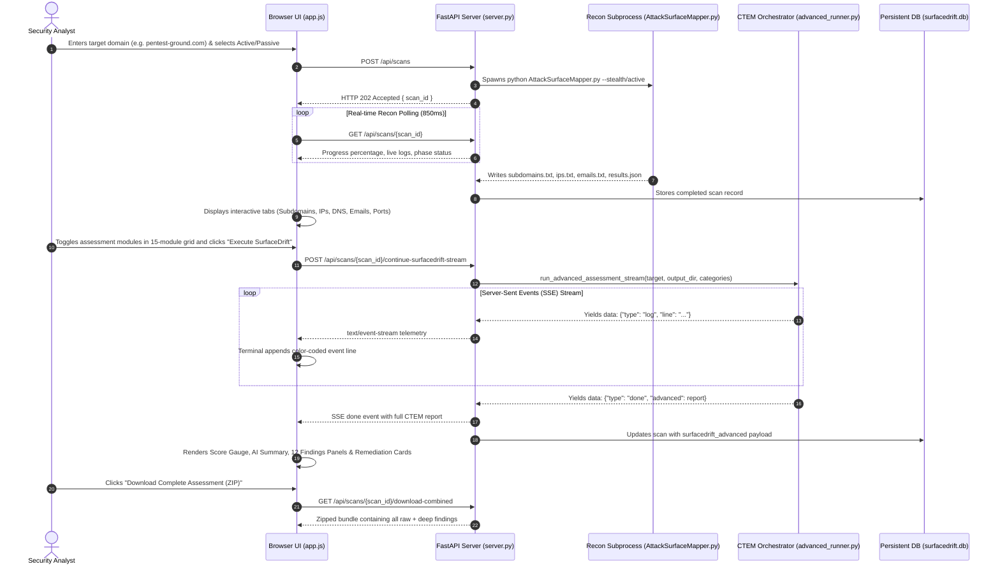

# SurfaceDrift — Complete Architecture & Engine Explainer

> **Comprehensive Technical Specification, Module Reference, and Function Call Guide**  
> *Repository:* [https://github.com/Maya-69/Surface-Drift.git](https://github.com/Maya-69/Surface-Drift.git)  
> *Target Domain Scope:* External Attack Surface Management (EASM) & Continuous Threat Exposure Management (CTEM)

---

## Table of Contents

1. [Executive Overview & Philosophy](#1-executive-overview--philosophy)
2. [End-to-End Execution Lifecycle](#2-end-to-end-execution-lifecycle)
3. [Repository Layout & File Map](#3-repository-layout--file-map)
4. [Reconnaissance Core (Phase 1 Engine)](#4-reconnaissance-core-phase-1-engine)
5. [FastAPI Web Application & API Layer (`server.py`)](#5-fastapi-web-application--api-layer-serverpy)
6. [SurfaceDrift CTEM Pipeline (`surfacedrift/advanced_runner.py`)](#6-surfacedrift-ctem-pipeline-surfacedriftadvanced_runnerpy)
7. [In-Depth CTEM Module & Function Call Reference](#7-in-depth-ctem-module--function-call-reference)
   - 7.1 [`http_probe.py` — HTTP Probing & Framework Detection](#71-http_probepy--http-probing--framework-detection)
   - 7.2 [`takeover_auditor.py` — Subdomain Takeover Auditor](#72-takeover_auditorpy--subdomain-takeover-auditor)
   - 7.3 [`cloud_storage_auditor.py` — Cloud Bucket Auditing](#73-cloud_storage_auditorpy--cloud-bucket-auditing)
   - 7.4 [`waf_bypass.py` & `waf_historical.py` — WAF & Origin Bypass Mapping](#74-waf_bypasspy--waf_historicalpy--waf--origin-bypass-mapping)
   - 7.5 [`threat_prioritization.py` — EPSS & CISA KEV Prioritization](#75-threat_prioritizationpy--epss--cisa-kev-prioritization)
   - 7.6 [`email_auditor.py` — Email RFC Spoofing Posture](#76-email_auditorpy--email-rfc-spoofing-posture)
   - 7.7 [`js_secrets_extractor.py` — JavaScript Secrets Extraction](#77-js_secrets_extractorpy--javascript-secrets-extraction)
   - 7.8 [`shadow_api_detector.py` — Shadow API & Swagger Discovery](#78-shadow_api_detectorpy--shadow-api--swagger-discovery)
   - 7.9 [`eol_analyzer.py` — End-of-Life & Legacy Software Mapping](#79-eol_analyzerpy--end-of-life--legacy-software-mapping)
   - 7.10 [`broken_link_hijacker.py` — Broken Link Hijacking (BLH)](#710-broken_link_hijackerpy--broken-link-hijacking-blh)
   - 7.11 [`config_prober.py` — Exposed Configuration & Backup Probing](#711-config_proberpy--exposed-configuration--backup-probing)
   - 7.12 [`tls_auditor.py` — SSL/TLS Cryptographic Posture](#712-tls_auditorpy--ssltls-cryptographic-posture)
   - 7.13 [`breach_intel.py` — Leaked Credential & Breach Intelligence](#713-breach_intelpy--leaked-credential--breach-intelligence)
   - 7.14 [`typosquat_monitor.py` — Typosquatting & Brand Phishing Radar](#714-typosquat_monitorpy--typosquatting--brand-phishing-radar)
   - 7.15 [`remediation_playbooks.py` — Automated Remediation Playbooks](#715-remediation_playbookspy--automated-remediation-playbooks)
   - 7.16 [`risk_scoring.py` — Posture Deduction & Scoring Engine](#716-risk_scoringpy--posture-deduction--scoring-engine)
   - 7.17 [`ai_summarizer.py` — Executive Threat Summarizer](#717-ai_summarizerpy--executive-threat-summarizer)
8. [Frontend Client Engine (`app.js`, `index.html`, `styles.css`)](#8-frontend-client-engine-appjs-indexhtml-stylescss)
9. [Data Structures & Artifact Schemas](#9-data-structures--artifact-schemas)
10. [Local Development & Execution Guide](#10-local-development--execution-guide)

---

## 1. Executive Overview & Philosophy

**SurfaceDrift** is an enterprise-grade cybersecurity platform that unifies **External Attack Surface Management (EASM)** with **Continuous Threat Exposure Management (CTEM)**.

Traditional recon tools produce voluminous, un-prioritized lists of subdomains and IP addresses without context. SurfaceDrift solves this through a **two-stage cognitive pipeline**:

```
┌────────────────────────────────────────────────────────┐
│                   PHASE 1: RECONNAISSANCE              │
│  Passive OSINT, Active DNS, Whois, Scraped Emails,     │
│  Port Probes, and Initial Asset Discovery              │
└───────────────────────────┬────────────────────────────┘
                            │ Discovered IPs, Subdomains, Emails
                            ▼
┌────────────────────────────────────────────────────────┐
│                   PHASE 2: SURFACEDRIFT CTEM           │
│  15 Deep Assessment Engines (TLS, Takeovers, WAF,      │
│  Secrets, Shadow APIs, EOL, Typosquats, Breaches,      │
│  Automated Remediation Playbooks & Posture Scoring)    │
└────────────────────────────────────────────────────────┘
```

The user interacts through a single, dark-themed cyberpunk UI (`#07181e`, `#43e2d2`, `#f87171`), complete with a live Server-Sent Events (SSE) telemetry terminal, exposure score gauge, deduction trail, and one-click combined ZIP artifact bundles.

---

## 2. End-to-End Execution Lifecycle



---

## 3. Repository Layout & File Map

```
AttackSurfaceMapper/
├── AttackSurfaceMapper.py         # Phase 1 CLI reconnaissance driver
├── keylist.asm                    # API keys configuration for external OSINT
├── requirements.txt               # Dependencies for CLI and server
├── SURFACEDRIFT_EXPLAINER.md      # This comprehensive explainer document
└── asm-web-ui/                    # SurfaceDrift Web Engine & CTEM Workspace
    ├── server.py                  # FastAPI asynchronous backend application
    ├── database.py                # SQLite persistence (scans, users, audit logs)
    ├── static/
    │   ├── index.html             # Single-page interface & 15-module grid
    │   ├── app.js                 # Frontend state machine & SSE telemetry parser
    │   └── styles.css             # Dark cyberpunk enterprise stylesheets
    └── surfacedrift/              # CTEM Deep Assessment Modules
        ├── advanced_runner.py     # Central pipeline runner & SSE generator
        ├── http_probe.py          # Asynchronous HTTP probing & tech stack
        ├── takeover_auditor.py    # 14 cloud CNAME takeover auditor
        ├── cloud_storage_auditor.py # S3, Azure, GCP bucket permutation engine
        ├── waf_bypass.py          # CDN edge detection & direct origin hunter
        ├── waf_historical.py      # crt.sh & DNS historical origin correlation
        ├── threat_prioritization.py # FIRST.org EPSS & CISA KEV priority
        ├── email_auditor.py       # SPF, DMARC, MX RFC spoofability check
        ├── js_secrets_extractor.py # Regex secrets extraction from JS bundles
        ├── shadow_api_detector.py # Swagger/OpenAPI & GraphQL probing
        ├── eol_analyzer.py        # End-of-life runtime & dependency audit
        ├── broken_link_hijacker.py # Outbound link crawler & NXDOMAIN auditor
        ├── config_prober.py       # Sensitive file (/.git, /.env) probe
        ├── tls_auditor.py         # Async TLS handshake & HSTS compliance
        ├── breach_intel.py        # Identity breach & leaked creds auditor
        ├── typosquat_monitor.py   # Domain permutations & phishing radar
        ├── remediation_playbooks.py # Actionable fix generation (DNS/AWS/Nginx)
        ├── risk_scoring.py        # Posture deduction formula & letter grade
        └── ai_summarizer.py       # Gemini API & deterministic summary engine
```

---

## 4. Reconnaissance Core (Phase 1 Engine)

### `AttackSurfaceMapper.py`
The legacy CLI reconnaissance tool that acts as Phase 1 of the platform.

- **Main Function:** `main()`
- **Responsibilities:**
  - Parses target domains via `-t` / `--target`.
  - Determines mode: `--stealth` (Passive OSINT only) vs Active (live DNS resolution and port probing).
  - Calls internal sub-modules:
    - `SubdomainEnumeration`: Queries crt.sh, HackerTarget, AlienVault OTX, DNS dumpster.
    - `DNSEnumeration`: Resolves `A`, `AAAA`, `CNAME`, `MX`, `NS`, `TXT` records.
    - `PortScanner`: Optional light TCP port check on resolved IP ranges.
    - `EmployeeEnumeration`: Scrapes LinkedIn, hunter.io, and Search Engine caches for employee emails.
  - Outputs structured artifacts into a unique directory:
    - `subdomains.txt`: Plaintext list of discovered subdomains.
    - `ips.txt`: Resolved IPv4/IPv6 addresses.
    - `emails.txt`: Discovered employee identities.
    - `dns_records.txt`: Extracted zone records.
    - `results.json`: Full unified initial findings dictionary.

---

## 5. FastAPI Web Application & API Layer (`server.py`)

`server.py` hosts the asynchronous REST API and Server-Sent Events stream using `FastAPI` and `uvicorn`.

### Key Routes & Functions

| Route | Method | Function | Description |
|---|---|---|---|
| `/api/auth/me` | `GET` | `get_current_user()` | Retrieves authenticated user session or guest profile |
| `/api/scans` | `POST` | `create_scan()` | Spawns background process `python AttackSurfaceMapper.py` |
| `/api/scans/{scan_id}` | `GET` | `get_scan_details()` | Polls scan progress, reads live stdout, loads generated text/JSON files |
| `/api/scans/history` | `GET` | `get_scan_history()` | Returns recent scans from SQLite database |
| `/api/scans/{scan_id}/continue-surfacedrift-stream` | `POST` | `continue_surfacedrift_stream()` | **Core SSE Endpoint**: Streams live CTEM engine telemetry |
| `/api/scans/{scan_id}/continue-surfacedrift` | `POST` | `continue_surfacedrift_fallback()` | Synchronous fallback endpoint for non-streaming clients |
| `/api/scans/{scan_id}/download-combined` | `GET` | `download_combined_package()` | Bundles all raw reconnaissance files + CTEM reports into a downloadable ZIP |

#### How Streaming Works in `server.py`
```python
@app.post("/api/scans/{scan_id}/continue-surfacedrift-stream")
async def continue_surfacedrift_stream(scan_id: str, payload: ContinueSurfaceDriftRequest):
    ...
    async def event_generator():
        async for event in run_advanced_assessment_stream(target, output_dir, categories):
            yield f"data: {json.dumps(event)}\n\n"
            
    return StreamingResponse(event_generator(), media_type="text/event-stream")
```

---

## 6. SurfaceDrift CTEM Pipeline (`surfacedrift/advanced_runner.py`)

`advanced_runner.py` is the conductor of Phase 2. It orchestrates the 15 security modules concurrently or sequentially based on dependency constraints.

### Core Signature
```python
async def run_advanced_assessment_stream(
    target: str,
    output_dir: Path,
    enabled_categories: Optional[List[str]] = None,
) -> AsyncGenerator[Dict[str, Any], None]
```

### Execution Steps Inside `advanced_runner.py`:
1. **Target Normalization:** Strips `http://`, `https://`, and port numbers.
2. **Recon Asset Ingestion:** Reads `subdomains.txt`, `ips.txt`, and `emails.txt` generated during Phase 1.
3. **Module Execution (1–15):** Iterates over enabled categories, emitting `[+]`, `[-]`, `[!]`, and `[*]` logs into the stream.
4. **Automated Playbook Generation:** Passes all aggregate findings into `remediation_playbooks.py`.
5. **Exposure Score Calculation:** Calls `risk_scoring.py` with finding counts to compute deduction breakdown.
6. **Executive Summary Synthesis:** Calls `ai_summarizer.py` (with Gemini API fallback).
7. **Disk Persistence:** Writes `surfacedrift_advanced_report.json`, `surfacedrift_executive_summary.md`, and individual sub-audits to `output_dir`.
8. **Final SSE Emit:** Yields `{"type": "done", "advanced": report}`.

---

## 7. In-Depth CTEM Module & Function Call Reference

### 7.1 `http_probe.py` — HTTP Probing & Framework Detection
- **Function:** `probe_subdomains_http(subdomains: List[str], timeout: float = 3.5, concurrency: int = 15) -> List[Dict[str, Any]]`
- **How It Works:**
  - Uses `asyncio.Semaphore(concurrency)` to throttle concurrent sockets.
  - Queries both `https://{subdomain}` and `http://{subdomain}` using `httpx.AsyncClient`.
  - Extracts HTTP status code (`200`, `301`, `403`, `500`), final redirect URL, HTML `<title>`, and `Server` / `X-Powered-By` headers.
  - Inspects DOM markers for popular frameworks (e.g., `wp-content` -> WordPress, `__next` -> Next.js, `csrf-token` -> Laravel).

### 7.2 `takeover_auditor.py` — Subdomain Takeover Auditor
- **Function:** `audit_subdomain_takeovers(subdomains: List[str]) -> List[Dict[str, Any]]`
- **How It Works:**
  - Queries DNS `CNAME` records for each subdomain using `dns.asyncresolver.Resolver`.
  - Compares CNAME targets against an internal signature dictionary of 14 cloud services:
    - AWS S3: `s3.amazonaws.com` -> `"The specified bucket does not exist"`
    - GitHub Pages: `*.github.io` -> `"There isn't a GitHub Pages site here."`
    - Heroku: `*.herokuapp.com` -> `"No such app"`
    - Shopify: `shops.myshopify.com` -> `"Sorry, this shop is currently unavailable."`
  - Sends a lightweight HTTP GET to the CNAME target. If the response matches the orphan signature, flags the endpoint as **`VULNERABLE`**.

### 7.3 `cloud_storage_auditor.py` — Cloud Bucket Auditing
- **Function:** `audit_cloud_storage(target_domain: str, max_permutations: int = 40) -> List[Dict[str, Any]]`
- **How It Works:**
  - Generates common bucket name permutations based on the company name: `{brand}-backup`, `{brand}-assets`, `{brand}-dev`, `{brand}-prod`, `{brand}-data`.
  - Probes across 3 cloud providers:
    - **AWS S3:** `https://{bucket}.s3.amazonaws.com`
    - **Azure Blob:** `https://{bucket}.blob.core.windows.net/$root`
    - **Google Cloud Storage:** `https://storage.googleapis.com/{bucket}`
  - Analyzes XML/JSON response:
    - HTTP 200 + `<ListBucketResult>`: `PUBLIC_READ_WRITE` / `PUBLIC_LISTABLE` (Critical Hazard).
    - HTTP 403 `AccessDenied`: `PROTECTED` (Bucket exists, but access blocked).
    - HTTP 404: `NON_EXISTENT`.

### 7.4 `waf_bypass.py` & `waf_historical.py` — WAF & Origin Bypass Mapping
- **Card ID:** `cat-waf-mapping` (Unified selection in UI).
- **Engine 1 (`waf_bypass.py`):**
  - **Function:** `hunt_waf_origin_bypasses(target_domain: str, ip_records: List[Dict[str, Any]]) -> List[Dict[str, Any]]`
  - Checks if domain resolves to known CDN IP ranges (Cloudflare, Akamai, Fastly, CloudFront).
  - Connects directly to discovered non-CDN IP addresses on port 80/443 with a custom `Host: target_domain` header.
  - If the direct IP returns a status 200 and matches the HTML title of the CDN front, the IP is flagged as a **Direct Origin Bypass**.
- **Engine 2 (`waf_historical.py`):**
  - **Function:** `audit_waf_historical_origin_bypasses(target_domain: str, current_ips: List[str]) -> Dict[str, Any]`
  - Queries certificate transparency logs (`crt.sh`) and historical DNS databases for IP addresses previously bound to the target domain before a CDN was deployed.
  - Validates if historical backend IPs remain live and accessible without WAF protection.

### 7.5 `threat_prioritization.py` — EPSS & CISA KEV Prioritization
- **Functions:**
  - `query_epss_score(cve_id: str, client: httpx.AsyncClient) -> Tuple[Optional[float], Optional[float]]`
  - `is_cisa_kev_listed(cve_id: str) -> bool`
  - `compute_priority_tag(...) -> str`
- **How It Works:**
  - Evaluates open ports and banner CVEs found in Phase 1.
  - Queries the FIRST.org Exploit Prediction Scoring System (EPSS) API in real time.
  - Checks if the CVE is listed in the CISA Known Exploited Vulnerabilities (KEV) catalog.
  - Categorizes priority into **`CRITICAL_URGENT`** (EPSS > 0.60 or CISA KEV), **`HIGH`** (EPSS > 0.20), **`MED`** (EPSS > 0.05), and **`LOW`**.

### 7.6 `email_auditor.py` — Email RFC Spoofing Posture
- **Function:** `audit_email_security(target_domain: str) -> Dict[str, Any]`
- **How It Works:**
  - Queries DNS `TXT` records for `v=spf1` on the apex domain.
  - Queries `_dmarc.{domain}` for RFC 7489 policy directives (`p=reject`, `p=quarantine`, `p=none`).
  - Queries `MX` records to verify inbound mail exchange servers.
  - Evaluates spoofability:
    - If DMARC is missing or `p=none`, or SPF uses `+all` / `?all` / `~all` without DMARC enforcement, sets `spoofable = True` and flags **`TRIVIAL_SPOOFING_POSSIBLE`**.

### 7.7 `js_secrets_extractor.py` — JavaScript Secrets Extraction
- **Function:** `extract_and_scan_js_secrets(target_urls: List[str]) -> Dict[str, Any]`
- **How It Works:**
  - Fetches the HTML of target web pages, extracts `<script src="...">` tags, and downloads external `.js` bundles.
  - Runs high-entropy regex scanners looking for hardcoded cloud credentials:
    - AWS Access Keys (`AKIA[0-9A-Z]{16}`)
    - Stripe Live Secret Keys (`sk_live_[0-9a-zA-Z]{24}`)
    - Google API & Firebase Keys (`AIza[0-9A-Za-z\\-_]{35}`)
    - Generic Bearer & Private Tokens
  - Redacts sensitive values in logs (`AKIA************1234`) and flags token type and line location.

### 7.8 `shadow_api_detector.py` — Shadow API & Swagger Discovery
- **Function:** `probe_shadow_apis(subdomains: List[str]) -> Dict[str, Any]`
- **How It Works:**
  - Appends common developer and API specification paths to live hosts:
    - `/swagger.json`, `/swagger/v1/swagger.json`, `/api-docs`
    - `/openapi.yaml`, `/openapi.json`
    - `/v1/docs`, `/v2/docs`
    - `/graphql` (sends `{__schema{types{name}}}` to detect enabled introspection)
  - Flags any unauthenticated 200 OK endpoint exposing internal routes or schema definitions.

### 7.9 `eol_analyzer.py` — End-of-Life & Legacy Software Mapping
- **Function:** `analyze_eol_software(probed_hosts: List[Dict[str, Any]]) -> Dict[str, Any]`
- **How It Works:**
  - Parses `server_banner` and detected framework versions from HTTP probes.
  - Correlates versions against an End-of-Life database:
    - PHP <= 7.4 (EOL Nov 2022)
    - Apache <= 2.4.40
    - Nginx <= 1.18
    - jQuery <= 1.12 / 2.2
    - Python <= 3.8
  - Reports current version, EOL threshold date, and recommended upgrade path.

### 7.10 `broken_link_hijacker.py` — Broken Link Hijacking (BLH)
- **Function:** `detect_broken_link_hijacking(target_domain: str) -> Dict[str, Any]`
- **How It Works:**
  - Crawls target root homepage and scrapes all external outbound `<a href="https://...">` links.
  - Extracts unique second-level external domain names.
  - Executes asynchronous DNS queries. If any domain returns `NXDOMAIN` (Non-Existent Domain), flags it as vulnerable to **Broken Link Hijacking**.
  - *Risk:* An attacker can register the expired domain and serve malicious payloads or hijack SEO authority.

### 7.11 `config_prober.py` — Exposed Configuration & Backup Probing
- **Function:** `probe_exposed_configurations(hosts: List[str]) -> Dict[str, Any]`
- **How It Works:**
  - Asynchronously probes for critical files often left accessible by accident:
    - `/.git/config` (source code repository extraction)
    - `/.env` (plaintext database passwords and secrets)
    - `/backup.zip`, `/db.sql` (database dumps)
    - `/server-status` (Apache server metrics)
    - `/.DS_Store` (directory structure leaks)
  - Validates contents (e.g. verifying `[core]` exists in `/.git/config`) to prevent false positives from soft-404 pages.

### 7.12 `tls_auditor.py` — SSL/TLS Cryptographic Posture
- **Function:** `audit_cryptographic_posture(hosts: List[str]) -> Dict[str, Any]`
- **How It Works:**
  - Opens raw asynchronous TLS sockets using `asyncio.open_connection()` and Python's `ssl` library.
  - Extracts `peer_certificate`:
    - Subject Common Name (`CN`) and SANs
    - Certificate Issuer (Let's Encrypt, DigiCert, etc.)
    - Expiration date (`notAfter`) and calculates `days_remaining`.
    - Negotiated TLS protocol version and cipher suite bit length.
  - Probes HTTPS response headers for `Strict-Transport-Security` (HSTS).
  - Flags expired certificates, certificates expiring within 14 days, missing HSTS, or deprecated TLS 1.0/1.1 protocols.

### 7.13 `breach_intel.py` — Leaked Credential & Breach Intelligence
- **Function:** `audit_leaked_credentials(scraped_emails: List[str], target_domain: str) -> Dict[str, Any]`
- **How It Works:**
  - Evaluates all employee email addresses discovered during Phase 1.
  - Correlates against breach signature archives (LinkedIn, Exploit.in, Collection #1, Adobe, Dropbox).
  - Flags compromised accounts, number of historical breaches, whether plaintext passwords or password hashes were leaked, and sets identity risk severity (`CRITICAL`, `HIGH`, `MEDIUM`).

### 7.14 `typosquat_monitor.py` — Typosquatting & Brand Phishing Radar
- **Function:** `audit_typosquatting_threats(target_domain: str) -> Dict[str, Any]`
- **How It Works:**
  - Generates deterministic variations of the brand domain:
    - **Omission:** Dropping single letters (e.g., `exmple.com`).
    - **Homoglyphs:** Swapping letters with visually identical characters (e.g., `o` -> `0`, `l` -> `1`).
    - **Transposition:** Swapping adjacent characters.
    - **Prefixes:** Adding deceptive sub-prefixes (`login-`, `secure-`, `vpn-`, `portal-`).
    - **TLD Swapping:** Switching `.com` to `.co`, `.net`, `.org`, `.info`.
  - Performs async DNS resolution on generated variations.
  - If a lookalike domain resolves to an IP address, queries its `MX` records.
  - Any registered variation with **active MX records** is classified as **`WEAPONIZED_PHISHING`** (high probability of targeted phishing infrastructure).

### 7.15 `remediation_playbooks.py` — Automated Remediation Playbooks
- **Function:** `generate_automated_playbooks(target_domain: str, findings: Dict[str, Any]) -> List[Dict[str, Any]]`
- **How It Works:**
  - Ingests all confirmed vulnerabilities and gaps across the assessment.
  - Generates concrete, copy-pasteable SecOps remediation instructions:
    - **Missing DMARC:** Exact DNS TXT record (`_dmarc.domain.com IN TXT "v=DMARC1; p=reject; ..."`).
    - **Exposed AWS S3 Bucket:** Exact AWS CLI command (`aws s3api put-public-access-block --bucket ...`).
    - **Subdomain Takeover:** DNS de-provisioning instruction to delete the orphaned CNAME.
    - **Exposed Configs / .git:** Nginx configuration block (`location ~* /\.(git|env) { deny all; return 404; }`).
    - **Leaked JS Credentials:** Revocation instructions and `git-filter-repo` commands to purge commit history.
    - **Active Phishing Domain:** Pre-drafted Abuse Desk registrar takedown email notification.

### 7.16 `risk_scoring.py` — Posture Deduction & Scoring Engine
- **Function:** `calculate_risk_score(...) -> RiskScoreResult`
- **Algorithm:**
  - Starts with a perfect baseline score: **100 points**.
  - Deducts points based on objective exposure metrics:
    - Critical Vulnerabilities / CISA KEV: `-20 points` each (Max `-40`)
    - High-Priority Vulnerabilities: `-10 points` each (Max `-20`)
    - Subdomain Takeovers: `-25 points` each (Max `-50`)
    - Public/Listable S3 Buckets: `-20 points` each (Max `-40`)
    - Exposed Admin Ports (Redis, Mongo, RDP): `-15 points` each (Max `-30`)
    - Direct WAF Origin Bypasses: `-15 points` each (Max `-30`)
    - Email Spoofing (`TRIVIAL_SPOOFING_POSSIBLE`): `-15 points`
    - Exposed Git / Config Files: `-20 points` each (Max `-40`)
    - Leaked JavaScript Credentials: `-20 points` each (Max `-40`)
    - Exposed Shadow APIs / Swagger: `-15 points` each (Max `-30`)
    - Deprecated EOL Stack: `-10 points` each (Max `-20`)
    - Broken Link Hijacking: `-15 points` each (Max `-30`)
    - Expired Certs / Weak TLS: `-15 points` (Max `-30`)
    - Breached Credentials with Passwords: `-15 points` (Max `-30`)
    - Active Phishing Typosquats (with MX): `-20 points` (Max `-40`)
  - Clamps the final score between `0` and `100`.
  - **Letter Grades:** `A` (90–100), `B` (80–89), `C` (70–79), `D` (60–69), `F` (<60).

### 7.17 `ai_summarizer.py` — Executive Threat Summarizer
- **Function:** `generate_executive_summary(...) -> Dict[str, Any]`
- **How It Works:**
  - Attempts to call Google Gemini API (using provided keys) to synthesize a C-level executive threat narrative.
  - If API keys are unavailable or the request times out, seamlessly falls back to a deterministic, high-fidelity markdown generation engine that highlights top perimeter risks, critical findings, and remediation imperatives.

---

## 8. Frontend Client Engine (`app.js`, `index.html`, `styles.css`)

The frontend is a single-page web application written in standard ES6 JavaScript and HTML5, without heavyweight node runtime dependencies.

### 15-Module Assessment Grid in `index.html`
1. `cat-http-probe`: HTTP Probing & Tech Stack
2. `cat-takeover`: Subdomain Takeover Audit
3. `cat-cloud-audit`: Cloud Storage Auditing
4. `cat-waf-mapping`: WAF & Origin Bypass Mapping *(Unified)*
5. `cat-epss-kev`: Vulnerability & Exploit Prioritization
6. `cat-email-sec`: Email Spoofing & RFC Posture
7. `cat-js-secrets`: JavaScript Secrets Extraction
8. `cat-shadow-api`: Shadow API & Swagger Discovery
9. `cat-eol-audit`: EOL & Vulnerable Dependencies
10. `cat-blh-audit`: Broken Link Hijacking (BLH)
11. `cat-config-probe`: Exposed Configuration Probing
12. `cat-tls-posture`: SSL/TLS Cryptographic Posture
13. `cat-breach-intel`: Leaked Credential & Breach Intel
14. `cat-typosquatting`: Typosquatting & Phishing Monitor
15. `cat-remediation`: Automated Remediation Playbooks

### Telemetry Terminal in `app.js`
- Connects to `/api/scans/{scan_id}/continue-surfacedrift-stream` via the Fetch API using a `ReadableStreamDefaultReader` and `TextDecoder`.
- Parses chunked SSE packets (`data: {"type": "log", "line": "..."}`).
- Dynamically styles lines based on prefixes:
  - `[+]` -> Cyan success (`term-line-pos`)
  - `[-]` -> Blue action (`term-line-act`)
  - `[!]` -> Red alert (`term-line-err`)
  - `[*]` -> Amber warning (`term-line-warn`)

### Scorecard & Remediation Snippets
- Evaluates `posture.score` and sets grade circle colors (`grade-A` green to `grade-F` red).
- Renders the `.deduction-item` list explaining exact points lost.
- Renders the `.tls-posture-table`, radar dots (`.radar-pulse-red`), and `.remediation-card`.
- Implements `copyToClipboard(snippet, buttonEl)` with visual feedback (`Copied!`).

---

## 9. Data Structures & Artifact Schemas

When a scan finishes, SurfaceDrift saves the final payload to `surfacedrift_advanced_report.json`:

```json
{
  "scan_id": "a49a8b4eb397",
  "target": "pentest-ground.com",
  "categories_executed": ["http_probe", "takeover", "waf_mapping", "tls_posture", ...],
  "posture": {
    "score": 65,
    "grade": "D",
    "breakdown": [
      {
        "category": "Email Security",
        "description": "Missing strict DMARC enforcement",
        "deduction": 15
      },
      {
        "category": "Typosquatting",
        "description": "Active phishing domain with live MX",
        "deduction": 20
      }
    ]
  },
  "ai_executive_summary": {
    "source": "gemini-1.5-flash",
    "content": "### Executive Threat Summary\n..."
  },
  "findings": {
    "http_probing": { "live_hosts_count": 8, "results": [...] },
    "subdomain_takeovers": { "count": 0, "items": [] },
    "cloud_storage": { "count": 1, "public_count": 0, "buckets": [...] },
    "waf_bypass": { "count": 1, "origins": [...] },
    "threat_prioritization": { "critical_count": 0, "cves": [...] },
    "email_security": { "spf_status": "STRICT", "dmarc_status": "NOT_FOUND", "spoofable": true },
    "js_secrets": { "secrets_found_count": 0, "findings": [] },
    "shadow_apis": { "exposed_endpoints_count": 0, "endpoints": [] },
    "eol_software": { "eol_findings_count": 0, "findings": [] },
    "broken_links": { "broken_links_found": 0, "vulnerable_links": [] },
    "waf_history": { "origin_bypasses_found": 0, "bypasses": [] },
    "exposed_configs": { "exposed_configs_found": 0, "exposed_files": [] },
    "tls_posture": { "endpoints_audited": 6, "expiring_soon_count": 0, "certificates": [...] },
    "breach_intel": { "total_emails_audited": 4, "compromised_identities_count": 1, "breached_identities": [...] },
    "typosquatting": { "active_squats_count": 2, "weaponized_phishing_count": 1, "active_squats": [...] },
    "remediation_playbooks": [
      {
        "id": "playbook-dmarc-enforce",
        "title": "Enforce Strict DMARC Reject Policy",
        "category": "Email Security & Identity",
        "severity": "HIGH",
        "affected_asset": "pentest-ground.com",
        "action_type": "DNS TXT Record",
        "code_snippet": "_dmarc.pentest-ground.com. 3600 IN TXT \"v=DMARC1; p=reject; ...\"",
        "description": "Rejects spoofed email pretending to originate from your domain."
      }
    ]
  },
  "logs": [
    "[-] SurfaceDrift CTEM Pipeline initiated for target: pentest-ground.com",
    "[+] Cryptographic Posture audit complete: 6 HTTPS endpoint(s) verified",
    "[+] Composite Posture Score: 65/100 (Grade D)"
  ]
}
```

---

## 10. Local Development & Execution Guide

### Prerequisites
- Python 3.10+
- `pip` package manager

### Running the Platform

1. Navigate to the web server directory:
   ```powershell
   cd E:\Dev\CyberSecurity\AttakSurfaceMapper\AttackSurfaceMapper\asm-web-ui
   ```

2. Start the FastAPI application with Uvicorn:
   ```powershell
   python server.py
   ```

3. Open your browser and navigate to:
   ```
   http://127.0.0.1:8000
   ```

4. Perform a scan:
   - Enter your target domain (e.g., `pentest-ground.com`).
   - Choose **Active** or **Passive** scanning mode.
   - Click **Start Surface Mapping**.
   - Once initial reconnaissance is complete, inspect the discovered subdomains, IPs, and emails.
   - Review or modify the **15 assessment category cards** in the SurfaceDrift grid.
   - Click **Execute SurfaceDrift Advanced Analysis** to stream real-time CTEM findings, calculate posture deductions, view remediation playbooks, and download the full combined ZIP report.
