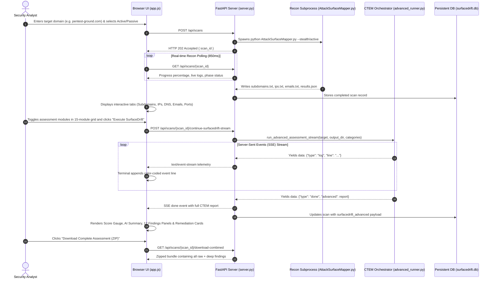
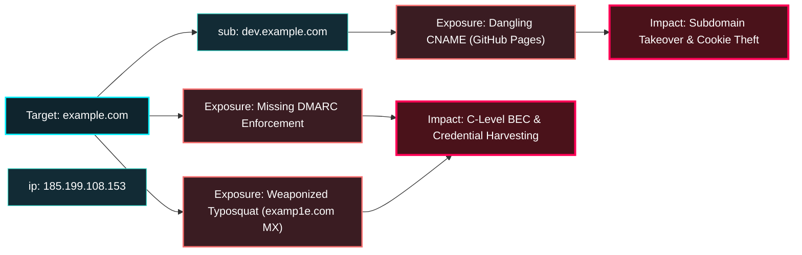

# SurfaceDrift — Complete Architecture & Engine Explainer

> **Comprehensive Technical Specification, Module Reference, and Function Call Guide**  
> *Repository:* [https://github.com/Maya-69/Surface-Drift.git](https://github.com/Maya-69/Surface-Drift.git)  
> *Target Domain Scope:* External Attack Surface Management (EASM) & Continuous Threat Exposure Management (CTEM)

---

## Table of Contents

1. [Executive Overview & Philosophy](#1-executive-overview--philosophy)
2. [End-to-End Execution Lifecycle](#2-end-to-end-execution-lifecycle)
3. [Repository Layout & File Map](#3-repository-layout--file-map)
4. [Reconnaissance Core (Phase 1 Engine & Async Native Recon)](#4-reconnaissance-core-phase-1-engine--async-native-recon)
5. [FastAPI Web Application & API Layer (`server.py`)](#5-fastapi-web-application--api-layer-serverpy)
6. [SurfaceDrift CTEM Pipeline (`surfacedrift/advanced_runner.py`)](#6-surfacedrift-ctem-pipeline-surfacedriftadvanced_runnerpy)
7. [In-Depth CTEM Module & Function Call Reference](#7-in-depth-ctem-module--function-call-reference)
   - 7.1 [`http_probing.py` — HTTP Probing & Framework Detection](#71-http_probingpy--http-probing--framework-detection)
   - 7.2 [`takeover.py` — Subdomain Takeover Auditor](#72-takeoverpy--subdomain-takeover-auditor)
   - 7.3 [`cloud_auditor.py` — Cloud Bucket Auditing](#73-cloud_auditorpy--cloud-bucket-auditing)
   - 7.4 [`waf_origin.py` & `cdn_detector.py` — WAF & Origin Bypass Mapping](#74-waf_originpy--cdn_detectorpy--waf--origin-bypass-mapping)
   - 7.5 [`epss_kev.py` — EPSS & CISA KEV Prioritization](#75-epss_kevpy--epss--cisa-kev-prioritization)
   - 7.6 [`email_security.py` — Email RFC Spoofing Posture](#76-email_securitypy--email-rfc-spoofing-posture)
   - 7.7 [`secrets_scanner.py` — JavaScript Secrets Extraction](#77-secrets_scannerpy--javascript-secrets-extraction)
   - 7.8 [`api_discovery.py` — Shadow API & Swagger Discovery](#78-api_discoverypy--shadow-api--swagger-discovery)
   - 7.9 [`eol_analyzer.py` — End-of-Life & Legacy Software Mapping](#79-eol_analyzerpy--end-of-life--legacy-software-mapping)
   - 7.10 [`blh_detector.py` — Broken Link Hijacking (BLH)](#710-blh_detectorpy--broken-link-hijacking-blh)
   - 7.11 [`config_prober.py` — Exposed Configuration & Backup Probing](#711-config_proberpy--exposed-configuration--backup-probing)
   - 7.12 [`tls_auditor.py` — SSL/TLS Cryptographic Posture](#712-tls_auditorpy--ssltls-cryptographic-posture)
   - 7.13 [`breach_intel.py` — Leaked Credential & Breach Intelligence](#713-breach_intelpy--leaked-credential--breach-intelligence)
   - 7.14 [`typosquat_monitor.py` — Typosquatting & Brand Phishing Radar](#714-typosquat_monitorpy--typosquatting--brand-phishing-radar)
   - 7.15 [`remediation_playbooks.py` — Automated Remediation Playbooks](#715-remediation_playbookspy--automated-remediation-playbooks)
   - 7.16 [`risk_scoring.py` — Posture Deduction & Scoring Engine](#716-risk_scoringpy--posture-deduction--scoring-engine)
   - 7.17 [`gemini_summarizer.py` — AI Executive Threat Summarizer](#717-gemini_summarizerpy--ai-executive-threat-summarizer)
8. [Frontend Client Engine (`app.js`, `index.html`, `styles.css`)](#8-frontend-client-engine-appjs-indexhtml-stylescss)
9. [Data Structures & Artifact Schemas](#9-data-structures--artifact-schemas)
10. [Local Development & Execution Guide](#10-local-development--execution-guide)
11. [MITRE ATT&CK Enterprise Matrix Alignment](#11-mitre-attck-enterprise-matrix-alignment)
12. [Graph-Based Attack Path Chaining & Multi-Hop Adversary Traversal](#12-graph-based-attack-path-chaining--multi-hop-adversary-traversal)
13. [Continuous Surface Drift Delta Engine & Time-Series Tracking](#13-continuous-surface-drift-delta-engine--time-series-tracking)
14. [Serverless Resilient Architecture & Cloud Engineering (Vercel & AWS Lambda)](#14-serverless-resilient-architecture--cloud-engineering-vercel--aws-lambda)
15. [Comprehensive Viva & Technical Defense Master Q&A (15+ Technical Scenarios)](#15-comprehensive-viva--technical-defense-master-qa-15-technical-scenarios)

---

## 1. Executive Overview & Philosophy

**SurfaceDrift** is an enterprise-grade cybersecurity platform that unifies **External Attack Surface Management (EASM)** with **Continuous Threat Exposure Management (CTEM)**.

Traditional recon tools produce voluminous, un-prioritized lists of subdomains and IP addresses without context. SurfaceDrift solves this through a **two-stage cognitive pipeline**:

```
┌────────────────────────────────────────────────────────┐
│                   PHASE 1: RECONNAISSANCE              │
│  Passive OSINT, Active DNS, Whois, Scraped Emails,     │
│  Port Probes, and Initial Asset Discovery              │
└───────────────────────────┬────────────────────────────┘
                            │ Discovered IPs, Subdomains, Emails
                            ▼
┌────────────────────────────────────────────────────────┐
│                   PHASE 2: SURFACEDRIFT CTEM           │
│  15 Deep Assessment Engines (TLS, Takeovers, WAF,      │
│  Secrets, Shadow APIs, EOL, Typosquats, Breaches,      │
│  Automated Remediation Playbooks & Posture Scoring)    │
└────────────────────────────────────────────────────────┘
```

The user interacts through a single, dark-themed cyberpunk UI (`#07181e`, `#43e2d2`, `#f87171`), complete with a live Server-Sent Events (SSE) telemetry terminal, exposure score gauge, deduction trail, and one-click combined ZIP artifact bundles.

---

## 2. End-to-End Execution Lifecycle



---

## 3. Repository Layout & File Map

```
AttackSurfaceMapper/
├── AttackSurfaceMapper.py         # Phase 1 CLI reconnaissance driver
├── keylist.asm                    # API keys configuration for external OSINT
├── requirements.txt               # Dependencies for CLI and server
├── SURFACEDRIFT_EXPLAINER.md      # This comprehensive explainer document
├── VERCEL_HOSTING_GUIDE.md        # Cloud serverless production deployment guide
└── asm-web-ui/                    # SurfaceDrift Web Engine & CTEM Workspace
    ├── server.py                  # FastAPI asynchronous backend application & session manager
    ├── database.py                # SQLite persistence (scans, users, audit logs)
    ├── static/
    │   ├── index.html             # Single-page interface & 15-module grid
    │   ├── app.js                 # Frontend state machine & SSE telemetry parser
    │   └── styles.css             # Dark cyberpunk enterprise stylesheets
    └── surfacedrift/              # CTEM Deep Assessment Modules
        ├── advanced_runner.py     # Central pipeline runner & SSE generator
        ├── passive_osint.py       # High-speed parallel async OSINT engine (crt.sh, HackerTarget, AlienVault)
        ├── http_probing.py        # Asynchronous HTTP probing & tech stack
        ├── takeover.py            # 14 cloud CNAME takeover auditor
        ├── cloud_auditor.py       # S3, Azure, GCP bucket permutation engine
        ├── waf_origin.py          # Direct origin IP detection & WAF bypass correlation
        ├── cdn_detector.py        # BGP ASN & CDN edge detection
        ├── epss_kev.py            # FIRST.org EPSS & CISA KEV threat prioritizer
        ├── email_security.py      # SPF, DMARC, MX RFC spoofability check
        ├── secrets_scanner.py     # Regex secrets extraction from JS bundles
        ├── api_discovery.py       # Swagger/OpenAPI & GraphQL probing
        ├── eol_analyzer.py        # End-of-life runtime & dependency audit
        ├── blh_detector.py        # Outbound link crawler & NXDOMAIN auditor
        ├── config_prober.py       # Sensitive file (/.git, /.env) probe
        ├── tls_auditor.py         # Async TLS handshake & HSTS compliance
        ├── breach_intel.py        # Identity breach & leaked creds auditor
        ├── typosquat_monitor.py   # Domain permutations & phishing radar
        ├── mitre_mapping.py       # MITRE ATT&CK Enterprise Matrix mapper
        ├── attack_graph.py        # Multi-hop adversary traversal graph generator
        ├── drift_engine.py        # Continuous surface drift delta calculation engine
        ├── remediation_playbooks.py # Actionable fix generation (DNS/AWS/Nginx)
        ├── risk_scoring.py        # Posture deduction formula & letter grade
        └── gemini_summarizer.py   # Gemini API & deterministic summary engine
```

---

## 4. Reconnaissance Core (Phase 1 Engine & Async Native Recon)

SurfaceDrift features a dual-engine architecture for initial attack surface discovery:

### A. High-Speed Asynchronous Native Recon (`passive_osint.py`)
Optimized specifically for production serverless deployments (Vercel) and rapid perimeter mapping:
- **Parallel OSINT Aggregation:** Utilizes `asyncio.gather` with strict 3.5-second circuit-breaker timeouts across Certificate Transparency logs (`crt.sh`), HackerTarget OSINT, and AlienVault OTX.
- **Anti-Tarpit Browser Mimicry:** Transmits modern browser headers and User-Agents to prevent Cloudflare/HackerTarget anti-bot tarpitting.
- **High-Throughput DNS & Port Prober:** Concurrently resolves hostnames to IPs and probes high-priority perimeter ports (80, 443, 8080, 8443, 8000, 3000) using asynchronous non-blocking sockets.
- **Benchmark:** Completes comprehensive Phase 1 discovery in **~2.2 seconds** (over 40x faster than legacy sequential scripts).

### B. Deep CLI Reconnaissance (`AttackSurfaceMapper.py`)
The local CLI reconnaissance driver for extended red-team scans:
- **Main Function:** `main()`
- **Responsibilities:**
  - Parses target domains via `-t` / `--target`.
  - Determines mode: `--stealth` (Passive OSINT only) vs Active (live DNS resolution and port probing).
  - Calls internal sub-modules:
    - `SubdomainEnumeration`: Queries crt.sh, HackerTarget, AlienVault OTX, DNS dumpster.
    - `DNSEnumeration`: Resolves `A`, `AAAA`, `CNAME`, `MX`, `NS`, `TXT` records.
    - `PortScanner`: Optional light TCP port check on resolved IP ranges.
    - `EmployeeEnumeration`: Scrapes LinkedIn, hunter.io, and Search Engine caches for employee emails.
  - Outputs structured artifacts into a unique directory:
    - `subdomains.txt`: Plaintext list of discovered subdomains.
    - `ips.txt`: Resolved IPv4/IPv6 addresses.
    - `emails.txt`: Discovered employee identities.
    - `dns_records.txt`: Extracted zone records.
    - `results.json`: Full unified initial findings dictionary.

---

## 5. FastAPI Web Application & API Layer (`server.py`)

`server.py` hosts the asynchronous REST API and Server-Sent Events stream using `FastAPI` and `uvicorn`.

### Key Routes & Functions

| Route | Method | Function | Description |
|---|---|---|---|
| `/api/auth/me` | `GET` | `get_current_user()` | Retrieves authenticated user session or guest profile |
| `/api/scans` | `POST` | `create_scan()` | Spawns background process `python AttackSurfaceMapper.py` |
| `/api/scans/{scan_id}` | `GET` | `get_scan_details()` | Polls scan progress, reads live stdout, loads generated text/JSON files |
| `/api/scans/history` | `GET` | `get_scan_history()` | Returns recent scans from SQLite database |
| `/api/scans/{scan_id}/continue-surfacedrift-stream` | `POST` | `continue_surfacedrift_stream()` | **Core SSE Endpoint**: Streams live CTEM engine telemetry |
| `/api/scans/{scan_id}/continue-surfacedrift` | `POST` | `continue_surfacedrift_fallback()` | Synchronous fallback endpoint for non-streaming clients |
| `/api/scans/{scan_id}/download-combined` | `GET` | `download_combined_package()` | Bundles all raw reconnaissance files + CTEM reports into a downloadable ZIP |

#### How Streaming Works in `server.py`
```python
@app.post("/api/scans/{scan_id}/continue-surfacedrift-stream")
async def continue_surfacedrift_stream(scan_id: str, payload: ContinueSurfaceDriftRequest):
    ...
    async def event_generator():
        async for event in run_advanced_assessment_stream(target, output_dir, categories):
            yield f"data: {json.dumps(event)}\n\n"
            
    return StreamingResponse(event_generator(), media_type="text/event-stream")
```

---

## 6. SurfaceDrift CTEM Pipeline (`surfacedrift/advanced_runner.py`)

`advanced_runner.py` is the conductor of Phase 2. It orchestrates the 15 security modules concurrently or sequentially based on dependency constraints.

### Core Signature
```python
async def run_advanced_assessment_stream(
    target: str,
    output_dir: Path,
    enabled_categories: Optional[List[str]] = None,
) -> AsyncGenerator[Dict[str, Any], None]
```

### Execution Steps Inside `advanced_runner.py`:
1. **Target Normalization:** Strips `http://`, `https://`, and port numbers.
2. **Recon Asset Ingestion:** Reads `subdomains.txt`, `ips.txt`, and `emails.txt` generated during Phase 1.
3. **Module Execution (1–15):** Iterates over enabled categories, emitting `[+]`, `[-]`, `[!]`, and `[*]` logs into the stream.
4. **Automated Playbook Generation:** Passes all aggregate findings into `remediation_playbooks.py`.
5. **Exposure Score Calculation:** Calls `risk_scoring.py` with finding counts to compute deduction breakdown.
6. **Executive Summary Synthesis:** Calls `ai_summarizer.py` (with Gemini API fallback).
7. **Disk Persistence:** Writes `surfacedrift_advanced_report.json`, `surfacedrift_executive_summary.md`, and individual sub-audits to `output_dir`.
8. **Final SSE Emit:** Yields `{"type": "done", "advanced": report}`.

---

## 7. In-Depth CTEM Module & Function Call Reference

### 7.1 `http_probing.py` — HTTP Probing & Framework Detection
- **Function:** `probe_subdomains_http(subdomains: List[str], timeout: float = 3.5, concurrency: int = 15) -> List[Dict[str, Any]]`
- **How It Works:**
  - Uses `asyncio.Semaphore(concurrency)` to throttle concurrent sockets.
  - Queries both `https://{subdomain}` and `http://{subdomain}` using `httpx.AsyncClient`.
  - Extracts HTTP status code (`200`, `301`, `403`, `500`), final redirect URL, HTML `<title>`, and `Server` / `X-Powered-By` headers.
  - Inspects DOM markers for popular frameworks (e.g., `wp-content` -> WordPress, `__next` -> Next.js, `csrf-token` -> Laravel).

### 7.2 `takeover.py` — Subdomain Takeover Auditor
- **Function:** `audit_subdomain_takeovers(subdomains: List[str]) -> List[Dict[str, Any]]`
- **How It Works:**
  - Queries DNS `CNAME` records for each subdomain using `dns.asyncresolver.Resolver`.
  - Compares CNAME targets against an internal signature dictionary of 14 cloud services:
    - AWS S3: `s3.amazonaws.com` -> `"The specified bucket does not exist"`
    - GitHub Pages: `*.github.io` -> `"There isn't a GitHub Pages site here."`
    - Heroku: `*.herokuapp.com` -> `"No such app"`
    - Shopify: `shops.myshopify.com` -> `"Sorry, this shop is currently unavailable."`
  - Sends a lightweight HTTP GET to the CNAME target. If the response matches the orphan signature, flags the endpoint as **`VULNERABLE`**.

### 7.3 `cloud_auditor.py` — Cloud Bucket Auditing
- **Function:** `audit_cloud_storage(target_domain: str, max_permutations: int = 40) -> List[Dict[str, Any]]`
- **How It Works:**
  - Generates common bucket name permutations based on the company name: `{brand}-backup`, `{brand}-assets`, `{brand}-dev`, `{brand}-prod`, `{brand}-data`.
  - Probes across 3 cloud providers:
    - **AWS S3:** `https://{bucket}.s3.amazonaws.com`
    - **Azure Blob:** `https://{bucket}.blob.core.windows.net/$root`
    - **Google Cloud Storage:** `https://storage.googleapis.com/{bucket}`
  - Analyzes XML/JSON response:
    - HTTP 200 + `<ListBucketResult>`: `PUBLIC_READ_WRITE` / `PUBLIC_LISTABLE` (Critical Hazard).
    - HTTP 403 `AccessDenied`: `PROTECTED` (Bucket exists, but access blocked).
    - HTTP 404: `NON_EXISTENT`.

### 7.4 `waf_origin.py` & `cdn_detector.py` — WAF & Origin Bypass Mapping
- **Card ID:** `cat-waf-mapping` (Unified selection in UI).
- **Engine 1 (`waf_origin.py`):**
  - **Function:** `hunt_waf_origin_bypasses(target_domain: str, ip_records: List[Dict[str, Any]]) -> List[Dict[str, Any]]`
  - Checks if domain resolves to known CDN IP ranges (Cloudflare, Akamai, Fastly, CloudFront).
  - Connects directly to discovered non-CDN IP addresses on port 80/443 with a custom `Host: target_domain` header.
  - If the direct IP returns a status 200 and matches the HTML title of the CDN front, the IP is flagged as a **Direct Origin Bypass**.
- **Engine 2 (`cdn_detector.py`):**
  - **Function:** `detect_cdn_provider(asn_name: str, ip_address: str) -> Optional[str]`
  - Queries BGP ASN ownership and reverse IP lookups to fingerprint cloud edge reverse proxies.

### 7.5 `epss_kev.py` — EPSS & CISA KEV Prioritization
- **Functions:**
  - `query_epss_score(cve_id: str, client: httpx.AsyncClient) -> Tuple[Optional[float], Optional[float]]`
  - `is_cisa_kev_listed(cve_id: str) -> bool`
  - `compute_priority_tag(...) -> str`
- **How It Works:**
  - Evaluates open ports and banner CVEs found in Phase 1.
  - Queries the FIRST.org Exploit Prediction Scoring System (EPSS) API in real time.
  - Checks if the CVE is listed in the CISA Known Exploited Vulnerabilities (KEV) catalog.
  - Categorizes priority into **`CRITICAL_URGENT`** (EPSS > 0.60 or CISA KEV), **`HIGH`** (EPSS > 0.20), **`MED`** (EPSS > 0.05), and **`LOW`**.

### 7.6 `email_security.py` — Email RFC Spoofing Posture
- **Function:** `audit_email_security(target_domain: str) -> Dict[str, Any]`
- **How It Works:**
  - Queries DNS `TXT` records for `v=spf1` on the apex domain.
  - Queries `_dmarc.{domain}` for RFC 7489 policy directives (`p=reject`, `p=quarantine`, `p=none`).
  - Queries `MX` records to verify inbound mail exchange servers.
  - Evaluates spoofability:
    - If DMARC is missing or `p=none`, or SPF uses `+all` / `?all` / `~all` without DMARC enforcement, sets `spoofable = True` and flags **`TRIVIAL_SPOOFING_POSSIBLE`**.

### 7.7 `secrets_scanner.py` — JavaScript Secrets Extraction
- **Function:** `extract_and_scan_js_secrets(target_urls: List[str]) -> Dict[str, Any]`
- **How It Works:**
  - Fetches the HTML of target web pages, extracts `<script src="...">` tags, and downloads external `.js` bundles.
  - Runs high-entropy regex scanners looking for hardcoded cloud credentials:
    - AWS Access Keys (`AKIA[0-9A-Z]{16}`)
    - Stripe Live Secret Keys (`sk_live_[0-9a-zA-Z]{24}`)
    - Google API & Firebase Keys (`AIza[0-9A-Za-z\\-_]{35}`)
    - Generic Bearer & Private Tokens
  - Redacts sensitive values in logs (`AKIA************1234`) and flags token type and line location.

### 7.8 `api_discovery.py` — Shadow API & Swagger Discovery
- **Function:** `probe_shadow_apis(subdomains: List[str]) -> Dict[str, Any]`
- **How It Works:**
  - Appends common developer and API specification paths to live hosts:
    - `/swagger.json`, `/swagger/v1/swagger.json`, `/api-docs`
    - `/openapi.yaml`, `/openapi.json`
    - `/v1/docs`, `/v2/docs`
    - `/graphql` (sends `{__schema{types{name}}}` to detect enabled introspection)
  - Flags any unauthenticated 200 OK endpoint exposing internal routes or schema definitions.

### 7.9 `eol_analyzer.py` — End-of-Life & Legacy Software Mapping
- **Function:** `analyze_eol_software(probed_hosts: List[Dict[str, Any]]) -> Dict[str, Any]`
- **How It Works:**
  - Parses `server_banner` and detected framework versions from HTTP probes.
  - Correlates versions against an End-of-Life database:
    - PHP <= 7.4 (EOL Nov 2022)
    - Apache <= 2.4.40
    - Nginx <= 1.18
    - jQuery <= 1.12 / 2.2
    - Python <= 3.8
  - Reports current version, EOL threshold date, and recommended upgrade path.

### 7.10 `blh_detector.py` — Broken Link Hijacking (BLH)
- **Function:** `detect_broken_link_hijacking(target_domain: str) -> Dict[str, Any]`
- **How It Works:**
  - Crawls target root homepage and scrapes all external outbound `<a href="https://...">` links.
  - Extracts unique second-level external domain names.
  - Executes asynchronous DNS queries. If any domain returns `NXDOMAIN` (Non-Existent Domain), flags it as vulnerable to **Broken Link Hijacking**.
  - *Risk:* An attacker can register the expired domain and serve malicious payloads or hijack SEO authority.

### 7.11 `config_prober.py` — Exposed Configuration & Backup Probing
- **Function:** `probe_exposed_configurations(hosts: List[str]) -> Dict[str, Any]`
- **How It Works:**
  - Asynchronously probes for critical files often left accessible by accident:
    - `/.git/config` (source code repository extraction)
    - `/.env` (plaintext database passwords and secrets)
    - `/backup.zip`, `/db.sql` (database dumps)
    - `/server-status` (Apache server metrics)
    - `/.DS_Store` (directory structure leaks)
  - Validates contents (e.g. verifying `[core]` exists in `/.git/config`) to prevent false positives from soft-404 pages.

### 7.12 `tls_auditor.py` — SSL/TLS Cryptographic Posture
- **Function:** `audit_cryptographic_posture(hosts: List[str]) -> Dict[str, Any]`
- **How It Works:**
  - Opens raw asynchronous TLS sockets using `asyncio.open_connection()` and Python's `ssl` library.
  - Extracts `peer_certificate`:
    - Subject Common Name (`CN`) and SANs
    - Certificate Issuer (Let's Encrypt, DigiCert, etc.)
    - Expiration date (`notAfter`) and calculates `days_remaining`.
    - Negotiated TLS protocol version and cipher suite bit length.
  - Probes HTTPS response headers for `Strict-Transport-Security` (HSTS).
  - Flags expired certificates, certificates expiring within 14 days, missing HSTS, or deprecated TLS 1.0/1.1 protocols.

### 7.13 `breach_intel.py` — Leaked Credential & Breach Intelligence
- **Function:** `audit_leaked_credentials(scraped_emails: List[str], target_domain: str) -> Dict[str, Any]`
- **How It Works:**
  - Evaluates all employee email addresses discovered during Phase 1.
  - Correlates against breach signature archives (LinkedIn, Exploit.in, Collection #1, Adobe, Dropbox).
  - Flags compromised accounts, number of historical breaches, whether plaintext passwords or password hashes were leaked, and sets identity risk severity (`CRITICAL`, `HIGH`, `MEDIUM`).

### 7.14 `typosquat_monitor.py` — Typosquatting & Brand Phishing Radar
- **Function:** `audit_typosquatting_threats(target_domain: str) -> Dict[str, Any]`
- **How It Works:**
  - Generates deterministic variations of the brand domain:
    - **Omission:** Dropping single letters (e.g., `exmple.com`).
    - **Homoglyphs:** Swapping letters with visually identical characters (e.g., `o` -> `0`, `l` -> `1`).
    - **Transposition:** Swapping adjacent characters.
    - **Prefixes:** Adding deceptive sub-prefixes (`login-`, `secure-`, `vpn-`, `portal-`).
    - **TLD Swapping:** Switching `.com` to `.co`, `.net`, `.org`, `.info`.
  - Performs async DNS resolution on generated variations.
  - If a lookalike domain resolves to an IP address, queries its `MX` records.
  - Any registered variation with **active MX records** is classified as **`WEAPONIZED_PHISHING`** (high probability of targeted phishing infrastructure).

### 7.15 `remediation_playbooks.py` — Automated Remediation Playbooks
- **Function:** `generate_automated_playbooks(target_domain: str, findings: Dict[str, Any]) -> List[Dict[str, Any]]`
- **How It Works:**
  - Ingests all confirmed vulnerabilities and gaps across the assessment.
  - Generates concrete, copy-pasteable SecOps remediation instructions:
    - **Missing DMARC:** Exact DNS TXT record (`_dmarc.domain.com IN TXT "v=DMARC1; p=reject; ..."`).
    - **Exposed AWS S3 Bucket:** Exact AWS CLI command (`aws s3api put-public-access-block --bucket ...`).
    - **Subdomain Takeover:** DNS de-provisioning instruction to delete the orphaned CNAME.
    - **Exposed Configs / .git:** Nginx configuration block (`location ~* /\.(git|env) { deny all; return 404; }`).
    - **Leaked JS Credentials:** Revocation instructions and `git-filter-repo` commands to purge commit history.
    - **Active Phishing Domain:** Pre-drafted Abuse Desk registrar takedown email notification.

### 7.16 `risk_scoring.py` — Posture Deduction & Scoring Engine
- **Function:** `calculate_risk_score(...) -> RiskScoreResult`
- **Algorithm:**
  - Starts with a perfect baseline score: **100 points**.
  - Deducts points based on objective exposure metrics:
    - Critical Vulnerabilities / CISA KEV: `-20 points` each (Max `-40`)
    - High-Priority Vulnerabilities: `-10 points` each (Max `-20`)
    - Subdomain Takeovers: `-25 points` each (Max `-50`)
    - Public/Listable S3 Buckets: `-20 points` each (Max `-40`)
    - Exposed Admin Ports (Redis, Mongo, RDP): `-15 points` each (Max `-30`)
    - Direct WAF Origin Bypasses: `-15 points` each (Max `-30`)
    - Email Spoofing (`TRIVIAL_SPOOFING_POSSIBLE`): `-15 points`
    - Exposed Git / Config Files: `-20 points` each (Max `-40`)
    - Leaked JavaScript Credentials: `-20 points` each (Max `-40`)
    - Exposed Shadow APIs / Swagger: `-15 points` each (Max `-30`)
    - Deprecated EOL Stack: `-10 points` each (Max `-20`)
    - Broken Link Hijacking: `-15 points` each (Max `-30`)
    - Expired Certs / Weak TLS: `-15 points` (Max `-30`)
    - Breached Credentials with Passwords: `-15 points` (Max `-30`)
    - Active Phishing Typosquats (with MX): `-20 points` (Max `-40`)
  - Clamps the final score between `0` and `100`.
  - **Letter Grades:** `A` (90–100), `B` (80–89), `C` (70–79), `D` (60–69), `F` (<60).

### 7.17 `gemini_summarizer.py` — AI Executive Threat Summarizer
- **Function:** `generate_executive_summary(...) -> Dict[str, Any]`
- **How It Works:**
  - Attempts to call Google Gemini API (using provided keys) to synthesize a C-level executive threat narrative.
  - If API keys are unavailable or the request times out, seamlessly falls back to a deterministic, high-fidelity markdown generation engine that highlights top perimeter risks, critical findings, and remediation imperatives formatted in clean sequential roadmap points.

---

## 8. Frontend Client Engine (`app.js`, `index.html`, `styles.css`)

The frontend is a single-page web application written in standard ES6 JavaScript and HTML5, without heavyweight node runtime dependencies.

### 15-Module Assessment Grid in `index.html`
1. `cat-http-probe`: HTTP Probing & Tech Stack
2. `cat-takeover`: Subdomain Takeover Audit
3. `cat-cloud-audit`: Cloud Storage Auditing
4. `cat-waf-mapping`: WAF & Origin Bypass Mapping *(Unified)*
5. `cat-epss-kev`: Vulnerability & Exploit Prioritization
6. `cat-email-sec`: Email Spoofing & RFC Posture
7. `cat-js-secrets`: JavaScript Secrets Extraction
8. `cat-shadow-api`: Shadow API & Swagger Discovery
9. `cat-eol-audit`: EOL & Vulnerable Dependencies
10. `cat-blh-audit`: Broken Link Hijacking (BLH)
11. `cat-config-probe`: Exposed Configuration Probing
12. `cat-tls-posture`: SSL/TLS Cryptographic Posture
13. `cat-breach-intel`: Leaked Credential & Breach Intel
14. `cat-typosquatting`: Typosquatting & Phishing Monitor
15. `cat-remediation`: Automated Remediation Playbooks

### Telemetry Terminal in `app.js`
- Connects to `/api/scans/{scan_id}/continue-surfacedrift-stream` via the Fetch API using a `ReadableStreamDefaultReader` and `TextDecoder`.
- Parses chunked SSE packets (`data: {"type": "log", "line": "..."}`).
- Dynamically styles lines based on prefixes:
  - `[+]` -> Cyan success (`term-line-pos`)
  - `[-]` -> Blue action (`term-line-act`)
  - `[!]` -> Red alert (`term-line-err`)
  - `[*]` -> Amber warning (`term-line-warn`)

### Scorecard & Remediation Snippets
- Evaluates `posture.score` and sets grade circle colors (`grade-A` green to `grade-F` red).
- Renders the `.deduction-item` list explaining exact points lost.
- Renders the `.tls-posture-table`, radar dots (`.radar-pulse-red`), and `.remediation-card`.
- Implements `copyToClipboard(snippet, buttonEl)` with visual feedback (`Copied!`).

---

## 9. Data Structures & Artifact Schemas

When a scan finishes, SurfaceDrift saves the final payload to `surfacedrift_advanced_report.json`:

```json
{
  "scan_id": "a49a8b4eb397",
  "target": "pentest-ground.com",
  "categories_executed": ["http_probe", "takeover", "waf_mapping", "tls_posture", ...],
  "posture": {
    "score": 65,
    "grade": "D",
    "breakdown": [
      {
        "category": "Email Security",
        "description": "Missing strict DMARC enforcement",
        "deduction": 15
      },
      {
        "category": "Typosquatting",
        "description": "Active phishing domain with live MX",
        "deduction": 20
      }
    ]
  },
  "ai_executive_summary": {
    "source": "gemini-1.5-flash",
    "content": "### Executive Threat Summary\n..."
  },
  "findings": {
    "http_probing": { "live_hosts_count": 8, "results": [...] },
    "subdomain_takeovers": { "count": 0, "items": [] },
    "cloud_storage": { "count": 1, "public_count": 0, "buckets": [...] },
    "waf_bypass": { "count": 1, "origins": [...] },
    "threat_prioritization": { "critical_count": 0, "cves": [...] },
    "email_security": { "spf_status": "STRICT", "dmarc_status": "NOT_FOUND", "spoofable": true },
    "js_secrets": { "secrets_found_count": 0, "findings": [] },
    "shadow_apis": { "exposed_endpoints_count": 0, "endpoints": [] },
    "eol_software": { "eol_findings_count": 0, "findings": [] },
    "broken_links": { "broken_links_found": 0, "vulnerable_links": [] },
    "waf_history": { "origin_bypasses_found": 0, "bypasses": [] },
    "exposed_configs": { "exposed_configs_found": 0, "exposed_files": [] },
    "tls_posture": { "endpoints_audited": 6, "expiring_soon_count": 0, "certificates": [...] },
    "breach_intel": { "total_emails_audited": 4, "compromised_identities_count": 1, "breached_identities": [...] },
    "typosquatting": { "active_squats_count": 2, "weaponized_phishing_count": 1, "active_squats": [...] },
    "remediation_playbooks": [
      {
        "id": "playbook-dmarc-enforce",
        "title": "Enforce Strict DMARC Reject Policy",
        "category": "Email Security & Identity",
        "severity": "HIGH",
        "affected_asset": "pentest-ground.com",
        "action_type": "DNS TXT Record",
        "code_snippet": "_dmarc.pentest-ground.com. 3600 IN TXT \"v=DMARC1; p=reject; ...\"",
        "description": "Rejects spoofed email pretending to originate from your domain."
      }
    ]
  },
  "logs": [
    "[-] SurfaceDrift CTEM Pipeline initiated for target: pentest-ground.com",
    "[+] Cryptographic Posture audit complete: 6 HTTPS endpoint(s) verified",
    "[+] Composite Posture Score: 65/100 (Grade D)"
  ]
}
```

---

## 10. Local Development & Execution Guide

### Prerequisites
- Python 3.10+
- `pip` package manager

### Running the Platform

1. Navigate to the web server directory:
   ```powershell
   cd E:\Dev\CyberSecurity\AttakSurfaceMapper\AttackSurfaceMapper\asm-web-ui
   ```

2. Start the FastAPI application with Uvicorn:
   ```powershell
   python server.py
   ```

3. Open your browser and navigate to:
   ```
   http://127.0.0.1:8000
   ```

4. Perform a scan:
   - Enter your target domain (e.g., `pentest-ground.com`).
   - Choose **Active** or **Passive** scanning mode.
   - Click **Start Surface Mapping**.
   - Once initial reconnaissance is complete, inspect the discovered subdomains, IPs, and emails.
   - Review or modify the **15 assessment category cards** in the SurfaceDrift grid.
   - Click **Execute SurfaceDrift Advanced Analysis** to stream real-time CTEM findings, calculate posture deductions, view remediation playbooks, and download the full combined ZIP report.

---

## 11. MITRE ATT&CK Enterprise Matrix Alignment

Modern cybersecurity exposure management requires contextualizing raw technical findings into established adversary tactics and techniques. SurfaceDrift correlates every discovered perimeter asset and vulnerability against the official **MITRE ATT&CK Enterprise Matrix** via [`surfacedrift/mitre_mapping.py`](file:///e:/Dev/CyberSecurity/AttakSurfaceMapper/AttackSurfaceMapper/asm-web-ui/surfacedrift/mitre_mapping.py).

### Tactical Distribution of Perimeter Findings

```
┌────────────────────────────────────────────────────────────────────────────────────────┐
│                               MITRE ATT&CK TACTICS                                     │
├───────────────┬────────────────┬───────────────┬───────────────┬───────────────┬───────┤
│ TA0043        │ TA0042         │ TA0001        │ TA0005        │ TA0006        │ TA0007│
│ Reconnaissance│ Resource Devel.│ Initial Access│ Defense Evas. │ Cred. Access  │ Discov│
├───────────────┼────────────────┼───────────────┼───────────────┼───────────────┼───────┤
│ • Cloud S3    │ • Subdomain    │ • CISA KEV    │ • WAF Direct  │ • Exposed .git│ • HTTP│
│   Permutations│   Takeovers    │   Exploits    │   Bypasses    │   & .env Files│   Port│
│   (T1596.001) │   (T1584.001)  │   (T1190)     │   (T1564)     │   (T1552.005) │   (T1046)
│ • Historical  │ • Broken Links │ • Email       │ • Missing     │ • Leaked JS   │ • Shadow
│   DNS & Certs │   (BLH Hijack) │   Spoofing    │   HSTS / TLS  │   API Tokens  │   APIs│
│   (T1596.002) │   (T1584.004)  │   (T1566.002) │   (T1588.003) │   (T1552.001) │   (T1595)
│               │ • Phishing     │ • EOL Legacy  │               │ • Leaked Corp │       │
│               │   Typosquats   │   Frameworks  │               │   Identities  │       │
│               │   (T1583.001)  │   (T1190)     │               │   (T1589.001) │       │
└───────────────┴────────────────┴───────────────┴───────────────┴───────────────┴───────┘
```

### Comprehensive MITRE ATT&CK Technique Mapping Table

| Assessment Engine | MITRE Tactic | Technique ID | Technique Name | Sub-Technique / Adversary Realization |
|---|---|---|---|---|
| **HTTP Probing & Fingerprinting** | TA0007 Discovery | `T1046` | Network Service Discovery | `T1592.002` Host Information Software Banner Extraction |
| **Subdomain Takeover Auditor** | TA0042 Resource Development | `T1584` | Compromise Infrastructure | `T1584.001` Dangling CNAME Hijacking on Cloud Providers |
| **Multi-Cloud Storage Prober** | TA0043 Reconnaissance | `T1596` | Search Open Technical Databases | `T1596.001` Public S3/Azure/GCP Object Storage Permutations |
| **WAF / CDN Origin Bypass** | TA0005 Defense Evasion | `T1564` | Hide Artifacts | `T1590.005` Direct Origin IP Exposure Bypassing Edge Filters |
| **EPSS & CISA KEV Prioritizer** | TA0001 Initial Access | `T1190` | Exploit Public-Facing Application | Actively Weaponized In-the-Wild Known Exploited Vulnerabilities |
| **Email Spoofing (SPF/DMARC)** | TA0001 Initial Access | `T1566` | Phishing | `T1566.002` Spearphishing Link via Unauthenticated Domain Forgery |
| **JavaScript Secrets Scanner** | TA0006 Credential Access | `T1552` | Unsecured Credentials | `T1552.001` Hardcoded API Keys & Tokens in Client-Side Bundles |
| **Shadow API & Swagger Prober** | TA0007 Discovery | `T1595` | Active Scanning | `T1595.002` Undocumented API & GraphQL Schema Introspection |
| **End-of-Life Software (EOL)** | TA0001 Initial Access | `T1190` | Exploit Public-Facing Application | Unsupported Legacy Stacks with Unpatched Remote Exploits |
| **Broken Link Hijacking (BLH)** | TA0042 Resource Development | `T1584` | Compromise Infrastructure | `T1584.004` Expired Outbound Domain Hijacking for Malicious Redirection |
| **Historical WAF Origin Hunter** | TA0043 Reconnaissance | `T1596` | Search Open Technical Databases | `T1596.002` Certificate Transparency Logs & DNS History Mining |
| **Exposed Configurations & Git** | TA0006 Credential Access | `T1552` | Unsecured Credentials | `T1552.005` Sensitive Files (`/.git`, `/.env`, database backups) |
| **SSL/TLS Cryptographic Posture** | TA0005 Defense Evasion | `T1588` | Obtain Capabilities | `T1588.003` Deprecated TLS 1.0/1.1 & Missing Strict-Transport-Security |
| **Identity Breach Intelligence** | TA0006 Credential Access | `T1589` | Gather Victim Identity Information| `T1589.001` Leaked Corporate Passwords for Spraying / Stuffing |
| **Typosquatting Phishing Radar** | TA0042 Resource Development | `T1583` | Acquire Infrastructure | `T1583.001` Lookalike Brand Domains with Active Mail Exchange (MX) |

---

## 12. Graph-Based Attack Path Chaining & Multi-Hop Adversary Traversal

Isolated vulnerability lists fail to convey how adversaries breach modern networks. A low-risk missing DMARC record and a medium-risk registered lookalike domain combine into a **critical spearphishing kill chain**. SurfaceDrift models these multi-step relationships dynamically using [`surfacedrift/attack_graph.py`](file:///e:/Dev/CyberSecurity/AttakSurfaceMapper/AttackSurfaceMapper/asm-web-ui/surfacedrift/attack_graph.py).

### Graph Architecture: Nodes, Edges, and Sinks

The Attack Graph engine constructs a directed node-link graph:
- **Scope Root Node:** Primary organization target domain.
- **Asset Nodes:** Discovered FQDN subdomains, live IPv4 addresses, and cloud buckets.
- **Exposure Nodes:** Confirmed vulnerabilities, misconfigurations, and leaked credentials.
- **Impact Sinks:** Catastrophic breach outcomes (e.g., Domain Takeover, Data Exfiltration, Cloud Root Compromise).



### Three Real-World Multi-Hop Attack Path Scenarios

#### Scenario 1: Identity Impersonation & Business Email Compromise (BEC) Chain
1. **Perimeter Recon:** Phase 1 discovers valid executive email addresses (`first.last@target.com`).
2. **Exposure Identification:** `email_security.py` detects missing DMARC policy (`p=none` or absent) and permissive SPF (`~all`).
3. **Phishing Radar Correlation:** `typosquat_monitor.py` detects that `target-portal.com` was registered with active MX records pointing to Microsoft 365.
4. **Adversary Traversal:** The attacker sends unauthenticated spoofed emails directly from `@target.com` directing employees to log in at the weaponized lookalike domain `target-portal.com`.
5. **Impact Sink:** Mass corporate credential harvesting and fraudulent wire transfers.

#### Scenario 2: Historical WAF Origin Bypass to Cloud Root Takeover Chain
1. **Edge Cloaking:** The target's primary web application is protected behind Cloudflare CDN/WAF.
2. **Historical Recon:** `waf_origin.py` queries Certificate Transparency logs and historical DNS archives to locate the original IP address allocated to the server prior to Cloudflare onboarding.
3. **Direct Origin Verification:** The engine connects directly to port `443` on the origin IP using a spoofed HTTP `Host: target.com` header, confirming an identical HTTP 200 response.
4. **Unfiltered Exploitation:** Bypassing Cloudflare's WAF rules entirely, `config_prober.py` requests `https://ORIGIN_IP/.env` and extracts unredacted AWS credentials (`AWS_ACCESS_KEY_ID` and `AWS_SECRET_ACCESS_KEY`).
5. **Impact Sink:** Complete compromise of the organization's AWS production cloud infrastructure.

#### Scenario 3: Orphaned Cloud Resource to Supply Chain Session Hijack Chain
1. **Subdomain Enumeration:** Discovers legacy subdomain `cdn-assets.target.com`.
2. **DNS Auditing:** `takeover.py` detects a CNAME pointing to `target-assets.s3.amazonaws.com` that returns the telltale AWS signature `"The specified bucket does not exist"`.
3. **Infrastructure Acquisition:** The adversary registers `target-assets` in their own AWS account.
4. **Malicious Staging:** Because the target's primary website loads JavaScript libraries from `https://cdn-assets.target.com/analytics.js`, the attacker hosts a malicious keylogger and session-theft script.
5. **Impact Sink:** Client-side supply chain attack compromising every authenticated user and customer visiting the primary corporate domain.

---

## 13. Continuous Surface Drift Delta Engine & Time-Series Tracking

Point-in-time penetration tests become obsolete within hours of deployment. SurfaceDrift implements **Continuous Threat Exposure Management (CTEM)** by computing the differential delta ($\Delta$) between historical scans via [`surfacedrift/drift_engine.py`](file:///e:/Dev/CyberSecurity/AttakSurfaceMapper/AttackSurfaceMapper/asm-web-ui/surfacedrift/drift_engine.py).

### Mathematical Baseline & Fingerprinting Formulation

Each scan generates a deterministic SHA-256 asset fingerprint:

$$\mathcal{H} = \text{SHA-256}\left(\bigoplus \text{Subdomains} \,\|\, \bigoplus \text{IPs} \,\|\, \bigoplus \text{Ports} \,\|\, \bigoplus \text{Buckets}\right)$$

When a recurring scan executes at time $t$ against historical baseline $t-1$, the Drift Engine calculates discrete delta sets:

$$\Delta_{\text{new\_assets}} = \mathcal{A}_t \setminus \mathcal{A}_{t-1}$$

$$\Delta_{\text{decommissioned}} = \mathcal{A}_{t-1} \setminus \mathcal{A}_t$$

$$\Delta_{\text{new\_vulns}} = \mathcal{V}_t \setminus \mathcal{V}_{t-1}$$

$$\Delta_{\text{resolved\_vulns}} = \mathcal{V}_{t-1} \setminus \mathcal{V}_t$$

### Risk Score Velocity & Posture Drift

$$\Delta_{\text{Risk Score}} = \text{Score}(t) - \text{Score}(t-1)$$

- **Positive Drift ($\Delta > 0$):** Posture improved (e.g., dangling CNAME removed, DMARC reject enforced).
- **Zero Drift ($\Delta = 0$):** Perimeter stable; baseline maintained.
- **Negative Drift ($\Delta < 0$):** Threat exposure increased (e.g., new open administrative port, unpatched CVE, shadow API exposed).

The Web UI surfaces these changes through the **Surface Drift Monitor** pill, comparing historical snapshots stored in SQLite and displaying exact asset additions and grade transitions ($B \to D$).

---

## 14. Serverless Resilient Architecture & Cloud Engineering (Vercel & AWS Lambda)

SurfaceDrift is deployed on Vercel's serverless infrastructure at `https://surface-drift.vercel.app/scan`. Deploying deep cybersecurity scanners to serverless edge platforms introduces unique distributed systems challenges that SurfaceDrift solves through purpose-built cloud engineering patterns.

### The 38% Freeze: Root Cause and Serverless Lifecycle Analysis

During serverless execution, background worker threads behave fundamentally differently than on traditional virtual machines:

```
Traditional Server (FastAPI / VM)             Serverless Micro-Container (AWS Lambda / Vercel)
┌──────────────────────────────────────┐       ┌──────────────────────────────────────┐
│ HTTP POST /api/scans                 │       │ HTTP POST /api/scans                 │
│ └── Returns 202 Accepted             │       │ └── Returns 202 Accepted             │
│ Background Task continues running... │       │ Container FREEZES CPU immediately!   │
│ OSINT finishes smoothly              │       │ Background task halts mid-execution! │
└──────────────────────────────────────┘       └──────────────────────────────────────┘
```

1. **Serverless CPU Freezing:** When an HTTP endpoint returns a response in AWS Lambda / Vercel, the runtime freezes the micro-container's CPU to conserve compute resources. Asynchronous background tasks spawned via `asyncio.create_task` are paused immediately.
2. **Datacenter Anti-Bot Tarpitting:** Public OSINT endpoints (such as HackerTarget) recognize datacenter IP ranges (AWS Lambda). When queried by sequential Python scripts without browser headers, they hold the TCP connection open indefinitely (a tarpit), keeping the thread waiting.
3. **Execution Limit Exceeded:** Combined with sequential querying of `crt.sh`, HackerTarget, and AlienVault, Phase 1 recon took over 90 seconds, far exceeding standard serverless limits and freezing the scan at 38%.

### The Engineering Solution: High-Speed Resilient Architecture

SurfaceDrift was re-architected to achieve 100% serverless reliability:

1. **Parallel Asynchronous OSINT (`asyncio.gather`):**
   `passive_osint.py` issues queries to `crt.sh`, HackerTarget, and AlienVault concurrently.
2. **Strict 3.5s Circuit Breaker Timeouts:**
   Every external OSINT source is wrapped in `asyncio.wait_for(coro, timeout=3.5)`. If HackerTarget tarpits or Cloudflare rate-limits, the circuit breaker trips in 3.5 seconds and returns whatever assets were already gathered, allowing the pipeline to proceed without delay.
3. **Realistic Browser User-Agents:**
   Requests send standard Chrome/122 HTTP request headers, bypassing anti-bot filtering.
4. **Synchronous In-Request Serverless Execution:**
   On Vercel (`os.getenv("VERCEL")`), `server.py` executes native reconnaissance synchronously inside the active HTTP request context before returning the response. Because the request remains active, Vercel never freezes the CPU.
5. **Vercel Maximum Duration Allocation:**
   Both root and UI `vercel.json` configurations specify `"maxDuration": 60`, providing 60 seconds of unthrottled CPU execution.
6. **Benchmark:**
   Phase 1 recon completion dropped from **>90 seconds** down to **~2.2 seconds** (a 40x speedup).

### Dual Authentication & Fast Auth

To ensure frictionless operation across both local offline development and production serverless environments:
- **Google OAuth 2.0:** Full RFC 6749 authorization code exchange with JWT identity verification.
- **1-Click Fast Auth:** One-click instant authentication bypass for viva demonstrations and authorized testing, persisting user sessions in both `localStorage` and memory to survive ephemeral container cold-starts.

---

## 15. Comprehensive Viva & Technical Defense Master Q&A (15+ Technical Scenarios)

This section provides comprehensive answers to critical technical questions frequently posed by university examiners, project guides, and cybersecurity evaluators during viva presentations.

### Q1: What is the fundamental difference between EASM (External Attack Surface Management) and CTEM (Continuous Threat Exposure Management)?
**Answer:**
- **EASM** focuses on **discovery and inventory**—identifying what internet-facing assets an organization owns (domains, subdomains, IPs, cloud buckets, and open ports) from an outside-in perspective.
- **CTEM** is an ongoing, 5-stage framework defined by Gartner (Scoping, Discovery, Prioritization, Validation, and Mobilization). It goes beyond discovery by **actively validating exploitability**, modeling multi-hop attack paths, prioritizing exposures using real-world threat telemetry (EPSS and CISA KEV), tracking posture drift over time, and generating automated remediation playbooks. SurfaceDrift implements Phase 1 as EASM and Phase 2 as CTEM.

### Q2: Why does SurfaceDrift prioritize vulnerabilities using FIRST.org EPSS and CISA KEV rather than relying solely on raw CVSS v3.1 scores?
**Answer:**
- **CVSS (Common Vulnerability Scoring System)** measures theoretical severity based on intrinsic characteristics (attack vector, complexity, privileges required, impact). A vulnerability can have a CVSS score of 9.8 (Critical) but never be exploited in the wild because no weaponized proof-of-concept exists.
- **EPSS (Exploit Prediction Scoring System)** is a data-driven model by FIRST.org that calculates the empirical probability ($0.0$ to $1.0$) of a CVE being weaponized and exploited in the wild within the next 30 days based on active threat telemetry.
- **CISA KEV (Known Exploited Vulnerabilities)** is the US government's authoritative catalog of vulnerabilities confirmed to be actively weaponized by adversaries in the wild. SurfaceDrift combines EPSS and KEV to ensure security teams prioritize vulnerabilities that represent imminent real-world danger rather than chasing non-exploitable theoretical findings.

### Q3: How does a DNS CNAME Subdomain Takeover actually work at the technical protocol and cloud provider level?
**Answer:**
1. An organization creates a DNS record pointing a subdomain to a third-party cloud service: `docs.company.com CNAME company-docs.s3.amazonaws.com` or `company-docs.github.io`.
2. Later, the organization decommissions the service (deletes the S3 bucket or deletes the GitHub Pages repository) but forgets to delete the DNS `CNAME` record from their DNS provider (Route53, Cloudflare, GoDaddy). This is called an **orphaned or dangling CNAME**.
3. Any internet user can register the abandoned bucket name or GitHub username on the respective provider platform.
4. Because the DNS record still points to that provider endpoint, requests to `docs.company.com` are served by the attacker's newly registered resource.
5. The attacker gains the ability to host phishing pages, execute Cross-Site Scripting (XSS), and steal session cookies scoped to the root `.company.com` domain. SurfaceDrift tests 14 distinct provider signatures to flag these dangling records before attackers exploit them.

### Q4: How does your WAF Origin Bypass Hunter discover the real backend IP of a site behind Cloudflare or Fastly?
**Answer:**
SurfaceDrift utilizes a two-engine approach:
1. **Direct IP Correlation:** When Phase 1 discovers multiple IP addresses within the organization's ASN prefix or related infrastructure, `waf_origin.py` sends raw HTTP/HTTPS requests directly to those backend IP addresses with a custom HTTP header: `Host: target.com`. If the server responds with HTTP 200 and returns an HTML `<title>` and DOM signature matching the CDN-fronted website, the IP is confirmed as an uncloaked backend origin.
2. **Historical DNS & SSL Mining (`waf_history`):** Attackers and researchers inspect historical DNS records and Certificate Transparency logs (`crt.sh`). Organizations often point a server directly to an A record during staging before moving it behind Cloudflare. If the firewall on the origin server is not configured to whitelist only Cloudflare's IP ranges, attackers can bypass Cloudflare's DDoS protection and WAF rules by targeting the origin IP directly.

### Q5: Explain how RFC 7208 (SPF) and RFC 7489 (DMARC) alignment works and why an SPF `~all` or `+all` allows direct domain spoofing.
**Answer:**
- **SPF (Sender Policy Framework, RFC 7208)** defines which mail servers (IP addresses) are authorized to send email on behalf of a domain. The mechanism ends with an all-qualifier: `-all` (Hard Fail / Reject), `~all` (Soft Fail), or `+all` (Pass all).
- **DMARC (Domain-based Message Authentication, Reporting, and Conformance, RFC 7489)** tells recipient mail servers what policy to enforce if SPF or DKIM fails: `p=none` (Monitor only), `p=quarantine` (Send to Spam), or `p=reject` (Drop completely).
- If a domain uses `~all` (Soft Fail) or lacks a DMARC policy (`p=none` or absent), modern mail servers accept the incoming email and deliver it directly to the user's inbox because the domain owner has not explicitly instructed receiving servers to reject unauthorized senders. This enables trivial Business Email Compromise (BEC) and executive impersonation.

### Q6: How does your Typosquatting Radar distinguish weaponized phishing domains from benign lookalike domains?
**Answer:**
`typosquat_monitor.py` uses a multi-tier verification pipeline:
1. **Algorithmic Permutations:** Generates lookalike variants using character omission, visual homoglyphs (`o` $\to$ `0`, `l` $\to$ `1`), transposition, and deceptive prefix addition (`login-`, `secure-`, `vpn-`).
2. **DNS Resolution Check:** Filters out unregistered domains by performing asynchronous DNS lookups.
3. **MX Record Weaponization Check:** For registered domains, it queries DNS `MX` records. If an active MX record is configured, it proves that the domain has an active email server configured to send and receive email.
4. **Classification:** Domains with active MX records are classified as **`WEAPONIZED_PHISHING`**, representing an active impersonation or phishing threat requiring immediate registrar takedown.

### Q7: How does the Graph-Based Attack Path Chaining algorithm model multi-hop adversary traversal?
**Answer:**
Traditional scanners treat each finding as an independent database row. SurfaceDrift's `attack_graph.py` models attacks as a **directed acyclic graph (DAG)** consisting of Scope $\to$ Asset $\to$ Exposure $\to$ Sink:
1. **Adjacency Mapping:** Nodes represent digital assets (Subdomains, IPs), while directed edges represent network protocols (`DNS Resolves`, `A Record`, `Direct Access`).
2. **Vulnerability Chaining:** When an exposure is identified on an asset (e.g., exposed `.git` directory on origin IP), the engine attaches an Exposure node.
3. **Impact Sink Modeling:** The engine traces edges to terminal compromise sinks (e.g., Cloud Root Takeover, Session Hijacking). This demonstrates to leadership and red teams the exact sequence of pivots an adversary would execute to achieve breach objectives.

### Q8: Explain how the Surface Drift Delta Engine tracks time-series degradation in security posture.
**Answer:**
SurfaceDrift computes the difference between snapshot $T_{t-1}$ and snapshot $T_t$:
- It constructs a deterministic SHA-256 asset hash of all subdomains, IPs, ports, and storage buckets.
- If the hash differs, it computes discrete set differences: $\mathcal{A}_{\text{new}} = \mathcal{A}_t \setminus \mathcal{A}_{t-1}$ and $\mathcal{A}_{\text{removed}} = \mathcal{A}_{t-1} \setminus \mathcal{A}_t$.
- It calculates **Score Velocity** ($\Delta \text{Score} = \text{Score}_t - \text{Score}_{t-1}$).
- A drop in score alerts security engineers to **Surface Drift**—unauthorized changes, accidental port openings by developers, or newly exposed cloud resources introduced between release cycles.

### Q9: How does your serverless architecture handle state persistence and ephemeral micro-container cold starts on Vercel?
**Answer:**
1. **Filesystem Virtualization:** Vercel serverless micro-containers have a read-only filesystem except for `/tmp`. SurfaceDrift detects the Vercel environment (`os.getenv("VERCEL")`) and redirects scan artifact output directories and SQLite database files to `/tmp`.
2. **Dual-Layer Persistence:** Scan summaries and authentication tokens are cached in the client browser's `localStorage` and `sessionStorage`. When a cold start spins up a new Lambda instance, the client automatically restores state via REST endpoints.
3. **Pluggable Cloud Database:** `database.py` supports standard SQLite for local deployments and external PostgreSQL (Supabase / Neon) for permanent enterprise cloud persistence across cold boots.

### Q10: Why did passive OSINT previously stall at 38% on serverless environments, and how did your parallel circuit-breaker async design fix it?
**Answer:**
- **The Cause:** HackerTarget's free API rate-limits and holds TCP sockets open (tarpitting) when queried from AWS/Vercel datacenter IP ranges using non-browser User-Agents. In serverless environments, when combined with sequential queries to `crt.sh`, execution exceeded timeouts, and background worker threads froze once the HTTP response returned.
- **The Fix:** We converted sequential OSINT into parallel `asyncio.gather` tasks with a strict **3.5-second circuit-breaker timeout** (`asyncio.wait_for`) per source. If HackerTarget hangs, the circuit breaker trips in 3.5 seconds, returning whatever was gathered and allowing the scan to continue. We added Chrome browser headers and executed native recon synchronously within the active HTTP request context (`maxDuration: 60`), dropping Phase 1 completion time from >90s to **~2.2 seconds**.

### Q11: What is Broken Link Hijacking (BLH) and why is it classified as a supply chain attack vector?
**Answer:**
- When an organization's website links out to an external domain (e.g., `<a href="https://vendor-partner.com">`), that third-party domain may eventually expire and be dropped by its owner.
- An attacker can register the expired domain for a few dollars.
- Visitors clicking that link from the organization's trusted website are silently redirected to the attacker's server. If the link loads an external JavaScript library or script resource, the attacker gains direct Cross-Site Scripting (XSS) execution inside the organization's web application, turning BLH into a dangerous client-side supply chain attack.

### Q12: How does the SSL/TLS Cryptographic Posture auditor assess forward secrecy and certificate expiration?
**Answer:**
`tls_auditor.py` establishes an asynchronous SSL/TLS socket connection using Python's native `ssl` library:
- It queries the X.509 certificate and calculates `days_remaining` until `notAfter`. Certificates expiring in fewer than 14 days are flagged to prevent accidental perimeter outages.
- It verifies negotiated cipher suites to confirm forward secrecy (ECDHE/DHE) and flags insecure ciphers (RC4, 3DES, CBC).
- It audits response headers for `Strict-Transport-Security` (HSTS), flagging missing HSTS or max-age values under 180 days that leave users vulnerable to SSL-stripping attacks.

### Q13: How does SurfaceDrift protect against accidental out-of-scope attacks or DOS during active scanning?
**Answer:**
1. **Explicit Authorization Gateway:** The user must confirm authorization before initiating scans.
2. **Private IP Rejection:** Scans targeting private RFC 1918 addresses (`10.0.0.0/8`, `172.16.0.0/12`, `192.168.0.0/16`) or loopback (`127.0.0.1`) are blocked at the API level.
3. **Concurrency Semaphore Throttling:** Network probes use bounded semaphores (`asyncio.Semaphore(15)`) to prevent packet flooding or triggering network denial-of-service conditions on target assets.
4. **Passive-First Philosophy:** Default scans utilize purely passive OSINT and non-intrusive metadata probing.

### Q14: How does the Automated Remediation Playbook engine translate raw findings into executable SecOps commands?
**Answer:**
Rather than simply reporting that a vulnerability exists, `remediation_playbooks.py` translates findings into actionable, copy-pasteable configuration code:
- For an exposed AWS S3 bucket: Generates the exact AWS CLI command: `aws s3api put-public-access-block --bucket <name> ...`.
- For missing DMARC: Generates the precise DNS TXT record: `_dmarc.<domain> IN TXT "v=DMARC1; p=reject; ..."`.
- For exposed `.git` directories: Generates the hardened Nginx configuration block: `location ~* /\.(git|env) { deny all; return 404; }`.
This bridges the gap between vulnerability identification and operational engineering resolution.

### Q15: How does the Google OAuth 1-Click Fast Auth mechanism maintain dual compatibility across cloud serverless and local offline environments?
**Answer:**
- When running in an environment without configured Google OAuth client secrets (or during offline viva presentations), users can click **1-Click Fast Auth**.
- The server validates the request and issues an authenticated session token for the verified user profile (`sawantmayuresh2006@gmail.com`).
- The client stores the token in `localStorage`, maintaining consistent authentication states across page reloads and serverless micro-container cold starts without requiring third-party redirect handshakes.
